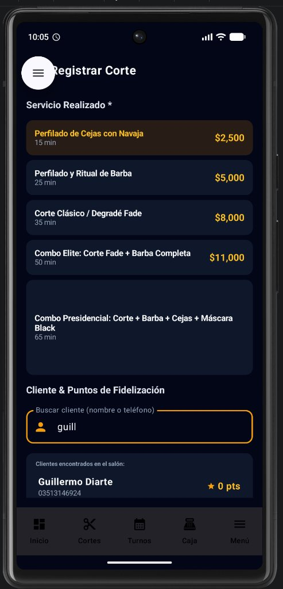
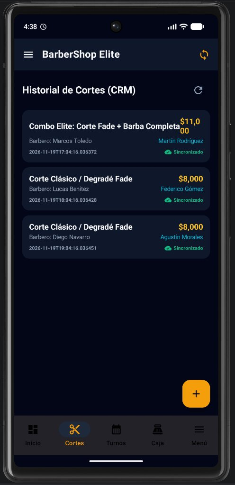

# 💈 BarberShop Elite — Sistema Integral de Gestión para Barberías

> **Stack:** React 18 + Vite · FastAPI + SQLite · TailwindCSS · JWT Auth · API-First

Sistema completo de gestión de alta gama para barberías. Incluye una página web pública moderna con estética oscura, panel de administración seguro, backend en Python con FastAPI y SQLAlchemy, y arquitectura API-First lista para alimentar una app móvil futura.

---

## 📋 Tabla de Contenidos

1. [Vista General de la Página Pública](#-página-pública)
2. [Panel de Administración](#-panel-de-administración)
3. [Aplicación Móvil Android (BarberiaApp)](#-aplicación-móvil-android-barberiaapp)
4. [Configuración de Marca](#-personalización-de-marca-env)
5. [Instalación y Puesta en Marcha](#-instalación-y-desarrollo-local)
6. [Despliegue en Producción (VPS & Dokploy)](#-despliegue-en-producción-vps)
7. [Gestión de Medios e Imágenes](#-gestión-de-medios-e-imágenes)
8. [Seguridad y Rutas de Acceso](#-seguridad-y-rutas-de-acceso)
9. [Credenciales de Prueba](#-credenciales-de-prueba)
10. [Arquitectura Técnica](#-arquitectura-técnica)
11. [API Reference](#-api-reference)

---

## 🌐 Página Pública

La página pública es completamente **responsiva** (mobile-first), carga rápido y cada sección puede habilitarse o deshabilitarse individualmente desde el panel de administración. Las secciones deshabilitadas desaparecen tanto del menú de navegación como del contenido de la página.

### Secciones de la Página

| ID Sección | Descripción | Configurable desde Admin |
|------------|-------------|:---:|
| **Inicio / Hero** | Banner animado con slider de fotos, título, subtítulo y botón de acción | ✅ |
| **Servicios** | Catálogo de cortes, barba, combos y promociones con precios en ARS | ✅ |
| **Reservar Turno** | Formulario de reserva online (desaparece cuando está pausado) | ✅ |
| **Puntos Elite** | Consulta de puntos de fidelización ingresando DNI o teléfono | ✅ |
| **Historia** | Sección "Nuestra Historia" con texto institucional | ✅ |
| **Galería** | Mosaico de fotos del salón y trabajos realizados | ✅ |
| **Equipo** | Cards del equipo de barberos con foto y especialidad | ✅ |
| **Contacto** | Mapa de Google Maps embebido, WhatsApp, horarios e info de contacto | ✅ |

### Menú de Navegación

- **Totalmente transparente** al inicio de la página
- **Efecto glassmorphism** (`bg-slate-950/80 + backdrop-blur`) al hacer scroll
- El clic en cada ítem del menú activa un **scroll suave** hasta la sección con offset de 70px para evitar que el header tape el contenido
- El botón **"Reservar Cita"** solo aparece en el menú si las reservas online están habilitadas en la configuración
- Las secciones deshabilitadas se eliminan automáticamente del menú

### Banner / Slider

- Slider de imágenes a pantalla completa con animación de fade + zoom suave
- Botones de navegación (◀ ▶) y puntos de paginación en la parte inferior
- El intervalo de transición es configurable desde el panel admin (en segundos)
- Si hay una sola imagen, los controles de navegación se ocultan automáticamente
- Las imágenes del banner se suben desde el admin, se convierten a **WebP** y se redimensionan a 1920px de ancho máximo

### Página 404

Cualquier URL que no exista muestra una página de error elegante con:
- Número 404 en dorado con animación
- Botón "Volver al Inicio"
- Botón "Contactar por WhatsApp"

---

## 🔧 Panel de Administración

### Acceso Seguro

| Ruta | Función |
|------|---------|
| `/gestion-elite` | Panel principal (redirige a login si no hay sesión) |
| `/gestion-elite/login` | Formulario de login del administrador |
| `/acceso-elite` | Alias alternativo (mismo destino) |
| `/admin`, `/gestion`, `/panel` | **Bloqueadas** — redirigen al inicio público |

> ⚠️ **Nunca compartas la URL del panel.** Las rutas `/admin` y similares están bloqueadas por código. Solo `/gestion-elite` permite acceder al sistema.

### Módulos del Panel

#### 1. 📊 Resumen General (Dashboard)
- Métricas del día: ingresos totales, cortes registrados, comisiones y gastos
- Alertas de inventario bajo stock
- Accesos rápidos a las acciones más frecuentes

#### 2. ✂️ Registrar Cortes (CRM)
- Registra cada servicio realizado: qué barbero, qué servicio, quién cobró (barbero o admin), canal de pago (efectivo / transferencia)
- El sistema calcula automáticamente la comisión del barbero y actualiza el saldo de puntos del cliente
- Accesible para todos los barberos y administradores

#### 3. 💰 Control de Caja & Liquidaciones _(solo Admin)_
- **Liquidación por Barbero (Turnos)**: Diseñado para barberos que rotan en turnos (ej. 4 horas a la mañana, otro 4 horas a la tarde). Permite liquidar a cada barbero de forma individual al terminar su jornada.
- **Múltiples cierres de turno en el mismo día**: Si un barbero realiza cortes a último momento tras su cierre, se acumulan para un segundo turno del mismo día sin alterar el cierre previo.
- **Frecuencia configurable por barbero o admin**: Liquidación diaria/turno, semanal, quincenal o mensual configurable al crear o editar el usuario.
- **Conciliación automática (¿Quién le debe a quién?)**: Cruza las comisiones ganadas contra el dinero que cada barbero retuvo físicamente o mediante transferencias directas a su cuenta.
- **Cierre Global de Caja (Fin del Día)**: Consolida todo el movimiento del día/período, computa el efectivo físico en cajón, transferencias bancarias a la barbería, gastos fijos/variables deducibles y la ganancia neta final del negocio. Si quedaron barberos pendientes, se liquidan todos juntos.
- **Historial completo con filtros**: Consulta de cierres globales y liquidaciones de turnos con desglose paso a paso.

#### 4. 🛠️ Servicios & Combos _(solo Admin)_
- Alta, edición y baja de servicios individuales y combos
- **Actualización masiva por inflación:** aumenta todos los precios en un % con redondeo inteligente a centenas
- Gestión de combos con inclusión de múltiples servicios

#### 5. 👥 Barberos & Esquemas _(solo Admin)_
- Alta, edición y baja de barberos
- Dos modelos de negocio soportados:
  - **Comisión:** el barbero recibe un % de cada corte (ej. 50%)
  - **Alquiler Fijo:** el barbero paga un monto mensual fijo al dueño
- Activación/desactivación de acceso al sistema (cancela sesión en tiempo real)

#### 6. 📦 Inventario & Stock
- Gestión de insumos internos (shampoo, cera, etc.) con descuento automático opcional al registrar un corte
- Alerta de stock bajo configurable
- Productos de reventa al cliente con comisión para el barbero vendedor

#### 7. 🛒 Ventas de Productos
- Registro de ventas de productos al cliente
- Vinculación con barbero vendedor para cálculo de comisión

#### 8. 🧾 Gastos del Salón _(solo Admin)_
- Registro de gastos operativos (alquiler, servicios, insumos, etc.)
- Integración con el control de caja

#### 9. 🏆 Clientes (Fidelización)
- Consulta y gestión de clientes por DNI o teléfono
- Visualización de historial de puntos y canjes

#### 10. 📅 Reservas & Turnos
- Gestión de reservas online recibidas desde la web pública
- Switch para pausar / reactivar las reservas online
- Visualización de seña abonada (si aplica)

#### 11. 🖼️ Galería & Medios _(solo Admin)_
- Explorador de archivos por carpeta: Banner, Galería Web, Equipo, Videos, Sistema (logos)
- Subida de imágenes y videos con conversión automática a WebP / WebM
- Vista previa en grilla, copia de URL, eliminación individual

#### 12. ⚙️ Configuración

La configuración tiene sub-secciones:

| Sub-sección | Descripción | Rol requerido |
|-------------|-------------|:---:|
| **🎨 Estilos & Temas** | Selector de 5 paletas de colores, favicon oficial y título de la pestaña del navegador | SuperAdmin |
| **👁️ Secciones de la Web** | Habilitar/deshabilitar secciones de la página pública | Admin |
| **🏪 Barbería y Ubicación** | Nombre, teléfono, dirección, URL de Google Maps | Admin |
| **🖼️ Banner & Slider** | Gestión de slides del hero: imagen, título, subtítulo, intervalo | Admin |
| **⭐ Fidelización y Puntos** | Puntos por cada $100 ARS, bonos, canjes | Admin |
| **💳 Cobros y Finanzas** | Alias/CBU para transferencias de señas, comisiones | Admin |
| **📅 Reservas y Turnos** | Switch ON/OFF reservas online, seña requerida | Admin |
| **📱 App Móvil & Barberos** | Generador de código QR para auto-vinculación de la app nativa, código de salón y guía para barberos | Admin |

### Temas Visuales Disponibles

| Tema | Paleta | Descripción |
|------|--------|-------------|
| 💈 **Poste de Barbero Tradicional** | Rojo · Blanco · Azul | Clásico vintage con barra tricolor animada |
| 👑 **Gold & Black Elite** | Dorado · Negro · Gris | Elegancia y lujo (tema por defecto) |
| 🌿 **Emerald & British Leather** | Esmeralda · Cuero · Oscuro | Estilo club inglés |
| ⚡ **Sapphire & Cyber Steel** | Azul eléctrico · Acero | Moderno y tecnológico |
| 🍷 **Ruby Burgundy & Rose Gold** | Borgoña · Oro rosa | Boutique y exclusivo |

---

## 📱 Aplicación Móvil Android (`BarberiaApp`)

El ecosistema cuenta con una **aplicación móvil Android nativa** (Kotlin + Jetpack Compose) pensada para el trabajo diario de los barberos en el salón, con funcionamiento **Offline-First** y arquitectura **Multi-Barbería (Multi-Tenant)**.

<div align="center">
  
  <p><em>Icono Oficial de la Aplicación (Diseño exclusivo, 100% libre de derechos de autor)</em></p>
</div>

### 📸 Vistas de la Aplicación Móvil

| Panel de Inicio / Turno | Registro de Cortes (Selector Compacto) | Historial CRM y Sincronización |
|:---:|:---:|:---:|
|  |  |  |

### 🌟 Características Principales

1. **Paridad Total de Funciones con la Web**:
   - **Registro rápido de cortes**: Selector compacto desplegable de servicios y combos (evitando listas largas en pantalla).
   - **Búsqueda predictiva de clientes**: Consulta en tiempo real sobre la base de datos local (nombre, teléfono y puntos de fidelización acumulados).
   - **Control de caja en vivo**: Arqueo del turno distinguiendo efectivo en cajón y transferencias digitales.
   - **Agenda y turnos**: Consulta y gestión de reservas online asignadas.
   - **Ventas e inventario**: Registro ágil de ventas de productos con actualización automática de stock.
   - **Módulos restringidos**: Gastos y configuraciones protegidos automáticamente según el rol del usuario (`admin` o `superadmin`).

2. **Arquitectura Multi-Barbería (Multi-Tenant Dinámico)**:
   - **Una sola app para todos tus clientes**: No es necesario compilar ni publicar una versión nueva en Google Play cada vez que sumas un cliente o salón nuevo.
   - **Vinculación por Código QR o Código Corto**: Desde el panel web (`/gestion-elite` → Configuración → *📱 App Móvil & Barberos*), el dueño dispone de un código QR y un código corto (ej: `elite`). El barbero simplemente escanea el QR con la cámara del celular o escribe el código al abrir la app por primera vez.
   - **Soporte Multi-Salón (Switch Barbershop)**: Un barbero que trabaja en dos barberías distintas con el mismo email y teléfono puede tener ambas vinculadas en su app y alternar entre ellas con **un solo toque** desde el menú lateral, sin tener que volver a ingresar contraseñas.

3. **Offline-First & Sincronización en Segundo Plano**:
   - Base de datos local **SQLite (Room Database)** que almacena clientes, servicios, productos y cortes en el propio dispositivo.
   - Si se corta Internet en el salón, los barberos pueden continuar cobrando y registrando cortes con total normalidad.
   - Al reconectarse a Internet, **WorkManager** sincroniza automáticamente los cortes pendientes y descarga los últimos datos del servidor.
   - Refresco inteligente automático al abrir o reanudar la app (`onResume`) y al navegar entre pestañas.
   - Detección de suspensión de cuentas: si una cuenta es revocada o desactivada por un administrador, la app purga los registros locales no sincronizados y finaliza la sesión de forma segura.

4. **Estándar de Moneda Regional (ARS)**:
   - Formato monetario regionalizado (`CurrencyFormatter.kt`): miles separados por punto (`$11.000`, `$8.000`) y centavos separados por coma, con prevención de saltos de línea antiestéticos.

5. **Iconografía Original y Cumplimiento de Google Play**:
   - Icono adaptive (`ic_launcher.xml` / `ic_launcher_round.xml`) para Android 8.0 a 14.
   - Recursos completos para todas las densidades de pantalla: `mdpi`, `hdpi`, `xhdpi`, `xxhdpi`, `xxxhdpi`.
   - Master icon de 512×512 px listo para la ficha oficial de Google Play Store (`BarberiaApp/ic_launcher-playstore.png`).

---

### 🛡️ Despliegue en Producción & Aislamiento Docker

Al desplegar en tu servidor (Dokploy, Docker o VPS), **los archivos de la aplicación móvil (`BarberiaApp/`) NO se copian en el contenedor ni consumen memoria ni disco del servidor**. Están explícitamente excluidos en `.dockerignore`:

```dockerignore
BarberiaApp
BarberiaApp/
BarberiaApp/**
.gradle
gradle
build
*.apk
*.aab
```

Esto asegura que la imagen Docker de producción se mantenga ultraligera, rápida de compilar y enfocada exclusivamente en el servidor web (FastAPI + React).

---

## ⚙️ Personalización de Marca (`.env`)

Todo el nombre y datos de la barbería están centralizados en el archivo `.env`. Para adaptar el sistema a un cliente diferente, **solo cambiás este archivo** y los cambios se propagan a toda la web y al panel admin:

```env
# ==============================================================================
# DATOS DE LA MARCA (Modificar aquí para cada cliente)
# ==============================================================================
VITE_BARBERSHOP_NAME="BarberShop Elite"
BARBERSHOP_NAME="BarberShop Elite"

VITE_BARBERSHOP_TAGLINE="Peluquería Masculina de Lujo & Cuidado Personal"
BARBERSHOP_TAGLINE="Peluquería Masculina de Lujo & Cuidado Personal"

VITE_BARBERSHOP_PHONE="+54 9 11 5555-1234"
BARBERSHOP_PHONE="+54 9 11 5555-1234"

VITE_BARBERSHOP_ADDRESS="Av. Santa Fe 2450, CABA, Argentina"
BARBERSHOP_ADDRESS="Av. Santa Fe 2450, CABA, Argentina"

VITE_BARBERSHOP_EMAIL="contacto@barbershopelite.com"
BARBERSHOP_EMAIL="contacto@barbershopelite.com"

VITE_BARBERSHOP_INSTAGRAM="barbershop.elite"
BARBERSHOP_INSTAGRAM="barbershop.elite"

VITE_BARBERSHOP_ALIAS="barbershop.elite.mp"
BARBERSHOP_ALIAS="barbershop.elite.mp"

VITE_CURRENCY="ARS"
CURRENCY="ARS"

# ==============================================================================
# CREDENCIALES INICIALES
# ==============================================================================
ADMIN_EMAIL="admin@barbershop.com"
ADMIN_PASSWORD="admin123"
ADMIN_NAME="Nombre del Dueño"

BARBER1_NAME="Marcos Toledo"
BARBER1_EMAIL="marcos@barbershop.com"
BARBER1_PASSWORD="barbero123"
BARBER1_COMMISSION=50.0

# (ver .env completo para más barberos)

# ==============================================================================
# CONFIGURACIÓN TÉCNICA
# ==============================================================================
JWT_SECRET_KEY="CAMBIA_ESTO_EN_PRODUCCION_clave_larga_y_segura"
DATABASE_URL="sqlite:///./barbershop.db"
PORT=8000
HOST="0.0.0.0"
```

> 🔐 **Importante:** Cambiá siempre `JWT_SECRET_KEY` antes de llevar a producción. Usá una cadena aleatoria larga.

---

## 🚀 Instalación y Desarrollo Local

### Requisitos

- **Node.js** ≥ 18
- **Python** ≥ 3.10
- `pip`, `venv`

### Pasos

```bash
# 1. Clonar el repositorio
git clone <URL_DEL_REPO> barberia
cd barberia

# 2. Instalar dependencias de Node
npm install

# 3. Crear entorno virtual de Python e instalar dependencias
python3 -m venv backend/venv
backend/venv/bin/pip install -r backend/requirements.txt

# 4. Instalar Pillow (para conversión WebP de imágenes)
backend/venv/bin/pip install Pillow

# 5. Copiar y editar el .env
cp .env.example .env
# Editar con tus datos

# 6. Sembrar la base de datos con usuarios demo y servicios de ejemplo
npm run seed

# 7. Iniciar el entorno de desarrollo (frontend + backend juntos)
npm run dev
```

### URLs en desarrollo

| Servicio | URL |
|---------|-----|
| Página web pública | http://localhost:3000 |
| Panel de administración | http://localhost:3000/gestion-elite |
| Login admin | http://localhost:3000/gestion-elite/login |
| Backend API | http://127.0.0.1:8000 |
| Documentación Swagger | http://127.0.0.1:8000/docs |

### Scripts disponibles

| Comando | Descripción |
|---------|-------------|
| `npm run dev` | Inicia frontend (Vite) y backend (uvicorn) simultáneamente |
| `npm run dev:frontend` | Solo el servidor Vite (puerto 3000) |
| `npm run dev:backend` | Solo el servidor FastAPI (puerto 8000) con --reload |
| `npm run build` | Compila el frontend para producción en `dist/` |
| `npm run serve` | Sirve la app compilada en producción (puerto 8000) |
| `npm run seed` | Siembra la base de datos con datos de ejemplo |

---

## 🌍 Despliegue en Producción (VPS & Dokploy)

El sistema está empaquetado para producción tanto mediante **Docker / Dokploy** (recomendado para multi-instancia) como mediante ejecución tradicional en VPS (Python + Vite).

---

### 🐳 Opción 1: Despliegue con Docker & Dokploy (Recomendado)

Cada cliente o barbería puede tener su propia aplicación aislada en Dokploy utilizando el archivo `Dockerfile` y `docker-compose.yml` provistos.

#### 1. Persistencia de Datos y Volúmenes
Es indispensable montar dos volúmenes persistentes en Dokploy para que no se pierdan los cortes, clientes ni imágenes subidas en futuros redeploys:

| Volumen del Contenedor | Tipo | Propósito |
|------------------------|------|-----------|
| `/app/data` | Named Volume (`barbershop_data`) | Base de datos SQLite (`barbershop.db`) |
| `/app/uploads` | Named Volume (`barbershop_uploads`) | Fotos de perfil, banners y comprobantes |

#### 2. Variables de Entorno en Dokploy

Configura las siguientes variables en la pestaña de variables de tu aplicación en Dokploy:

```env
PORT=8000
HOST=0.0.0.0
DATABASE_URL=sqlite:////app/data/barbershop.db
UPLOADS_DIR=/app/uploads
JWT_SECRET_KEY=clave_super_secreta_y_aleatoria_para_esta_barberia
BARBERSHOP_NAME="BarberShop Elite"
CURRENCY=ARS
ADMIN_EMAIL=admin@tudominio.com
ADMIN_PASSWORD=contraseña_segura
SEED_ON_START=true
```

> 💡 **Nota sobre `SEED_ON_START=true`**: Al arrancar por primera vez, el contenedor crea automáticamente las tablas y el usuario administrador inicial si no existen. En los arranques posteriores, si la base ya existe en `/app/data`, no sobreescribe nada.

#### 3. Aislamiento de la App Móvil (`.dockerignore`)
El archivo `.dockerignore` del repositorio excluye automáticamente la carpeta `BarberiaApp/`, archivos `.apk`, `.aab` y cachés de Gradle. Al volver a desplegar en Dokploy, **no se copia ningún archivo de la app móvil al contenedor**, manteniendo la imagen ultra liviana y rápida de compilar.

---

### 🖥️ Opción 2: Despliegue Manual en VPS (Python + PM2)

El backend FastAPI está configurado para servir directamente los archivos compilados de React (`dist/`). En producción **solo corrés un proceso en un solo puerto**.

```bash
# 1. Clonar en el VPS
git clone <URL_DEL_REPO> barberia
cd barberia

# 2. Instalar dependencias
python3 -m venv backend/venv
backend/venv/bin/pip install -r backend/requirements.txt
backend/venv/bin/pip install Pillow
npm install

# 3. Configurar variables de entorno
nano .env
# → Cambiar JWT_SECRET_KEY por una clave segura
# → Cambiar contraseñas de admin y barberos

# 4. Sembrar la base de datos
npm run seed

# 5. Compilar el frontend
npm run build

# 6. Iniciar en producción
npm run serve
# O con PM2 para mantenerlo activo:
pm2 start "backend/venv/bin/uvicorn backend.app.main:app --host 0.0.0.0 --port 80" --name "barberia"
pm2 save
pm2 startup
```

Una vez levantado:
- `http://TU_IP_O_DOMINIO/` → Página web pública
- `http://TU_IP_O_DOMINIO/gestion-elite/login` → Panel de administración
- `http://TU_IP_O_DOMINIO/api/...` → API REST (misma instancia, sin CORS)

> 💡 **Recomendado:** Poner Nginx como reverse proxy delante para manejar SSL (HTTPS), dominios y archivos estáticos servidos de forma eficiente.

### Nginx (ejemplo básico)

```nginx
server {
    listen 80;
    server_name tudominio.com;

    location / {
        proxy_pass http://127.0.0.1:8000;
        proxy_set_header Host $host;
        proxy_set_header X-Real-IP $remote_addr;
        client_max_body_size 50M;
    }
}
```

---

## 🖼️ Gestión de Medios e Imágenes

### Estructura de Carpetas `uploads/`

```
uploads/
├── banner/     → Imágenes del hero/slider (max 1920px, WebP)
├── galeria/    → Fotos de la galería web (max 1400px, WebP)
├── equipo/     → Fotos del equipo de barberos (max 800px, WebP)
├── sistema/    → Logos, favicon e imágenes del sistema (max 512px, WebP)
└── videos/     → Videos del salón (convertidos a WebM)
```

### Proceso de Optimización Automática

Cuando subís una imagen desde el panel de administración:

1. ✅ Se corrige la orientación automáticamente (EXIF)
2. ✅ Se redimensiona proporcionalmente según la carpeta destino
3. ✅ Se convierte a formato **WebP** (imágenes) o **WebM** (videos)
4. ✅ Se guarda con nombre único basado en timestamp
5. ✅ Se devuelve la URL para usar en el sistema

> Los formatos WebP/WebM reducen el tamaño hasta un 40-70% respecto a JPG/PNG/MP4, logrando cargas más rápidas.

### Desde el Panel Admin

- **Configuración → Banner & Slider:** Subir/reemplazar fotos del hero
- **Galería & Medios:** Explorar, subir y eliminar archivos por carpeta

---

## 🔐 Seguridad y Rutas de Acceso

### Rutas de Admin Protegidas

```
/gestion-elite         → Panel admin (requiere login)
/gestion-elite/login   → Formulario de login
/acceso-elite          → Alias alternativo
/acceso-elite/login    → Alias alternativo de login
```

### Rutas Bloqueadas (redirigen al inicio)

```
/admin    → Redirige a /
/gestion  → Redirige a /
/panel    → Redirige a /
```

### Rutas Desconocidas

Cualquier URL que no exista muestra la **página 404** con opción de volver al inicio o contactar por WhatsApp.

### Autenticación

- **JWT Bearer Token** con expiración configurable
- Token almacenado en `localStorage` (persiste entre pestañas y reinicios del browser)
- Si el admin desactiva un usuario, su sesión se invalida en el próximo request
- El ErrorBoundary captura errores JS en runtime y ofrece limpieza de sesión

### Control de Acceso por Rol (RBAC)

| Función | Barbero | Admin | SuperAdmin |
|---------|:---:|:---:|:---:|
| Registrar cortes | ✅ | ✅ | ✅ |
| Ver inventario | ✅ | ✅ | ✅ |
| Ventas productos | ✅ | ✅ | ✅ |
| Turnos y reservas | ✅ | ✅ | ✅ |
| Control de Caja | ❌ | ✅ | ✅ |
| Servicios & combos | ❌ | ✅ | ✅ |
| Gestión barberos | ❌ | ✅ | ✅ |
| Gastos del salón | ❌ | ✅ | ✅ |
| Galería & medios | ❌ | ✅ | ✅ |
| Configuración | ❌ | ✅ | ✅ |
| Cambiar tema visual | ❌ | ❌ | ✅ |
| Favicon & Título de pestaña | ❌ | ❌ | ✅ |

---

## 🔑 Credenciales de Prueba

El sistema incluye datos sembrados automáticamente al ejecutar `npm run seed`:

| Rol | Email | Contraseña | Esquema |
|-----|-------|------------|---------|
| **SuperAdmin** | `guillermo.diarte@gmail.com` | *(configurado)* | Acceso total + temas |
| **Admin / Dueño** | `admin@barbershop.com` | `admin123` | Acceso total sin temas |
| **Barbero 1** | `marcos@barbershop.com` | `barbero123` | Comisión 50% |
| **Barbero 2** | `lucas@barbershop.com` | `barbero123` | Comisión 45% |
| **Barbero 3** | `diego@barbershop.com` | `barbero123` | Alquiler fijo $120.000 ARS/mes |

> En la pantalla de login hay botones de **acceso rápido de demo** para ingresar con 1 clic durante el desarrollo.

---

## 🏗️ Arquitectura Técnica

### Stack Completo

```
┌─────────────────────────────────────────────────────┐
│  FRONTEND (React 18 + Vite)                         │
│  ┌──────────────────┐  ┌──────────────────────────┐ │
│  │  Página Pública  │  │   Panel Administración   │ │
│  │  (SPA pública)   │  │   (SPA privada con RBAC) │ │
│  └──────────────────┘  └──────────────────────────┘ │
│  TailwindCSS · Framer Motion · Lucide Icons · shadcn │
└──────────────────────────┬──────────────────────────┘
                           │ /api/* (proxy Vite en dev)
                           │ (mismo proceso en prod)
┌──────────────────────────▼──────────────────────────┐
│  BACKEND (FastAPI + SQLAlchemy)                     │
│  ┌────────────────────────────────────────────────┐ │
│  │  API REST JWT · 14 Routers · Pydantic Schemas  │ │
│  └────────────────────────────────────────────────┘ │
│  Python 3.10+ · uvicorn · python-jose · passlib    │
└──────────────────────────┬──────────────────────────┘
                           │
┌──────────────────────────▼──────────────────────────┐
│  BASE DE DATOS (SQLite)                             │
│  barbershop.db — fácil de migrar a PostgreSQL       │
└─────────────────────────────────────────────────────┘
```

### Estructura de Archivos

```
Barberia/
├── backend/
│   ├── app/
│   │   ├── main.py           ← FastAPI app + CORS + static files
│   │   ├── models.py         ← Modelos SQLAlchemy (ORM)
│   │   ├── schemas.py        ← Schemas Pydantic (validación)
│   │   ├── auth.py           ← JWT + dependencias de autenticación
│   │   ├── database.py       ← Conexión SQLite
│   │   ├── utils.py          ← Helpers
│   │   └── routers/
│   │       ├── auth.py           ← Login / refresh token
│   │       ├── services.py       ← Servicios & combos
│   │       ├── barbers.py        ← Gestión de barberos
│   │       ├── service_records.py← Registro de cortes (CRM core)
│   │       ├── inventory.py      ← Inventario & stock
│   │       ├── product_sales.py  ← Ventas de productos
│   │       ├── expenses.py       ← Gastos del salón
│   │       ├── cash_closing.py   ← Control de Caja
│   │       ├── customers.py      ← Clientes & fidelización
│   │       ├── rewards.py        ← Sistema de puntos
│   │       ├── bookings.py       ← Reservas online
│   │       ├── settings.py       ← Configuración del sistema
│   │       ├── stats.py          ← Dashboard & métricas
│   │       └── media.py          ← Subida/gestión de medios
│   ├── seed.py               ← Script de datos iniciales
│   ├── requirements.txt
│   └── venv/
├── src/
│   ├── App.jsx               ← Router principal + rutas protegidas
│   ├── main.jsx              ← Entry point React
│   ├── api.js                ← Cliente HTTP centralizado
│   ├── config.js             ← Variables de marca desde .env
│   ├── index.css             ← Estilos globales + scroll suave
│   ├── components/
│   │   ├── Header.jsx        ← Navegación responsiva + scroll suave
│   │   ├── Hero.jsx          ← Slider/banner principal
│   │   ├── Services.jsx      ← Catálogo de servicios
│   │   ├── BookingSection.jsx← Reservas online
│   │   ├── LoyaltyCheckSection.jsx ← Consulta de puntos
│   │   ├── About.jsx         ← Historia de la barbería
│   │   ├── Gallery.jsx       ← Galería de fotos
│   │   ├── Team.jsx          ← Equipo de barberos
│   │   ├── Contact.jsx       ← Contacto + Google Maps embed
│   │   ├── Footer.jsx        ← Pie de página
│   │   └── NotFound.jsx      ← Página 404
│   ├── admin/
│   │   ├── AdminLayout.jsx   ← Sidebar + navegación admin
│   │   ├── AdminLogin.jsx    ← Formulario de login
│   │   └── tabs/
│   │       ├── DashboardTab.jsx
│   │       ├── CutsTab.jsx
│   │       ├── CashClosingTab.jsx
│   │       ├── ServicesTab.jsx
│   │       ├── BarbersTab.jsx
│   │       ├── InventoryTab.jsx
│   │       ├── SalesTab.jsx
│   │       ├── ExpensesTab.jsx
│   │       ├── LoyaltyTab.jsx
│   │       ├── BookingsTab.jsx
│   │       ├── GalleryTab.jsx
│   │       └── SettingsTab.jsx
│   └── context/
│       ├── AuthContext.jsx   ← Estado de sesión JWT global
│       └── ThemeContext.jsx  ← Tema visual + secciones + banner
├── uploads/
│   ├── banner/               ← Fotos del hero (WebP, max 1920px)
│   ├── galeria/              ← Galería web (WebP, max 1400px)
│   ├── equipo/               ← Fotos de barberos (WebP, max 800px)
│   ├── sistema/              ← Logos & favicon (WebP, max 512px)
│   └── videos/               ← Videos (WebM)
├── dist/                     ← Build de producción (generado)
├── .env                      ← Variables de entorno (NO commitear)
├── vite.config.js
├── tailwind.config.js
└── package.json
```

---

## 📡 API Reference

La documentación interactiva completa (Swagger UI) está disponible en:
- Desarrollo: http://127.0.0.1:8000/docs
- Producción: http://TU_DOMINIO/docs

### Endpoints Principales

| Módulo | Prefijo | Auth requerida |
|--------|---------|:--------------:|
| Autenticación | `/api/auth` | Pública (login) |
| Configuración pública | `/api/settings/public` | ❌ Pública |
| Configuración admin | `/api/settings` | ✅ Admin |
| Servicios | `/api/services` | ✅ |
| Barberos | `/api/barbers` | ✅ Admin |
| Cortes / CRM | `/api/service-records` | ✅ |
| Inventario | `/api/inventory` | ✅ |
| Ventas | `/api/product-sales` | ✅ |
| Gastos | `/api/expenses` | ✅ Admin |
| Caja | `/api/cash-closing` | ✅ Admin |
| Clientes | `/api/customers` | ✅ |
| Puntos | `/api/rewards` | ✅ |
| Reservas | `/api/bookings` | ✅ |
| Estadísticas | `/api/stats` | ✅ |
| Medios | `/api/media` | ✅ Admin |

### Autenticación

```bash
# Login
POST /api/auth/login
Content-Type: application/json
{ "email": "admin@barbershop.com", "password": "admin123" }

# Respuesta: { "access_token": "eyJ...", "token_type": "bearer", "user": {...} }

# Usar en requests autenticados:
Authorization: Bearer eyJ...
```

---

## 🛠️ Notas de Desarrollo

### Convención Importante: Import de Iconos de Lucide

Lucide exporta un componente `Image` que **colisiona** con el constructor nativo del browser `window.Image`. Siempre importar con alias:

```jsx
// ✅ Correcto
import { Image as ImageIcon } from 'lucide-react';

// ❌ Nunca así (causa "Failed to construct 'Image'"en runtime)
import { Image } from 'lucide-react';
```

### Reinicio del Servidor de Desarrollo

Después de cambios en rutas del router React (App.jsx), es necesario forzar una recarga sin caché en el browser:

- **Mac:** `Cmd + Shift + R`
- **Windows/Linux:** `Ctrl + Shift + R`
- O desde DevTools: click derecho en el ícono de recarga → "Vaciar caché y forzar recarga"

### Variables de Entorno

- Las variables con prefijo `VITE_` son accesibles en el frontend via `import.meta.env.VITE_*`
- Las variables sin prefijo son exclusivas del backend Python
- **Nunca commitear el archivo `.env`** con credenciales reales

---

## 📄 Licencia

Sistema propietario desarrollado para uso interno. Todos los derechos reservados.
