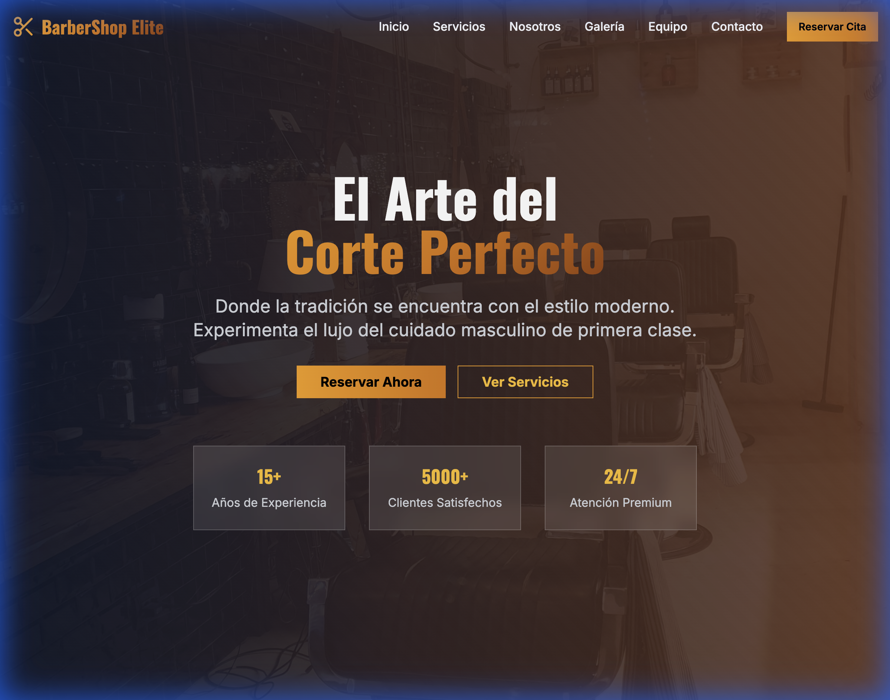
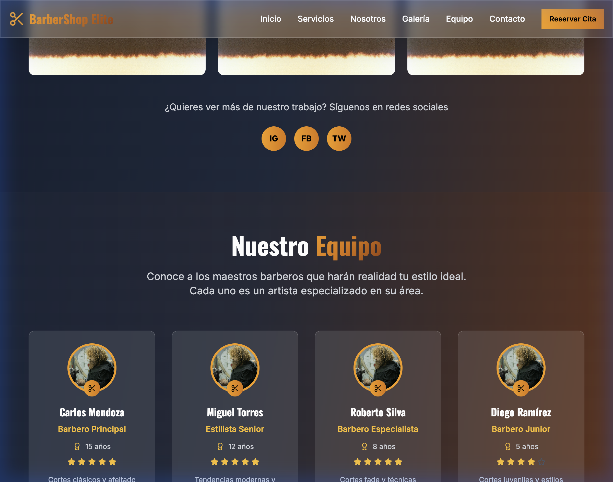

# Barberia Web App

Bienvenido al repositorio del sitio web de Barberia. Este proyecto es una aplicación web moderna construida con Vite y React, diseñada para ofrecer una experiencia de usuario premium para una barbería.

## 📋 Descripción

La aplicación permite a los usuarios ver información sobre la barbería, conocer al equipo, y ver los servicios ofrecidos.

## 🚀 Cómo ejecutar en local

Sigue estos pasos para ejecutar el proyecto en tu máquina local:

### Prerrequisitos
- Node.js instalado en tu sistema.

### Instalación y Ejecución

1.  **Instalar dependencias:**
    Abre una terminal en la carpeta del proyecto y ejecuta:
    ```bash
    npm install
    ```

2.  **Iniciar el servidor de desarrollo:**
    Una vez instaladas las dependencias, inicia el servidor con:
    ```bash
    npm run dev
    ```

3.  **Abrir en el navegador:**
    El servidor iniciará generalmente en `http://localhost:5173`. Abre esa dirección en tu navegador para ver la aplicación.

## 📸 Screenshots

Aquí hay algunas imágenes de cómo se ve la página:

### Página de Inicio


### Nuestro Equipo y Características
